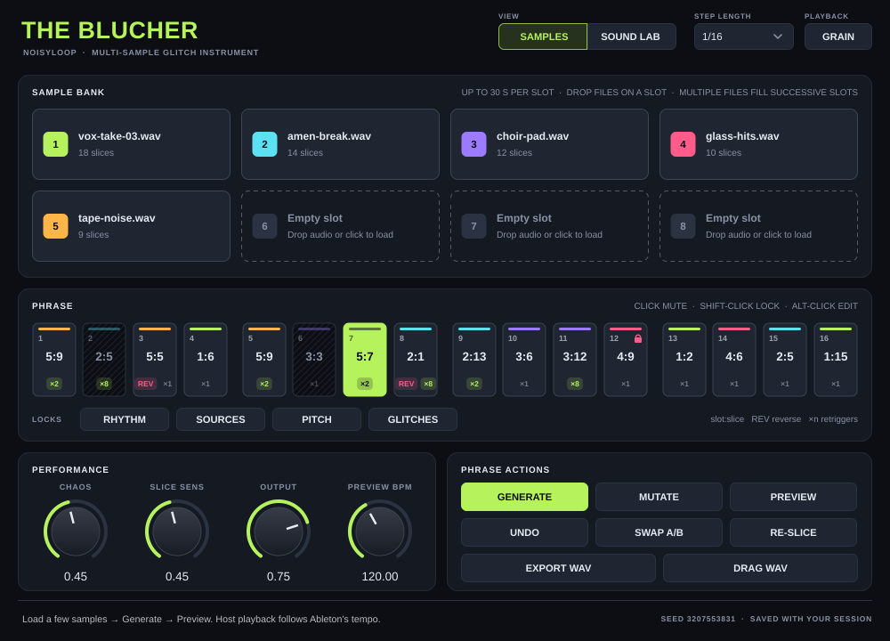
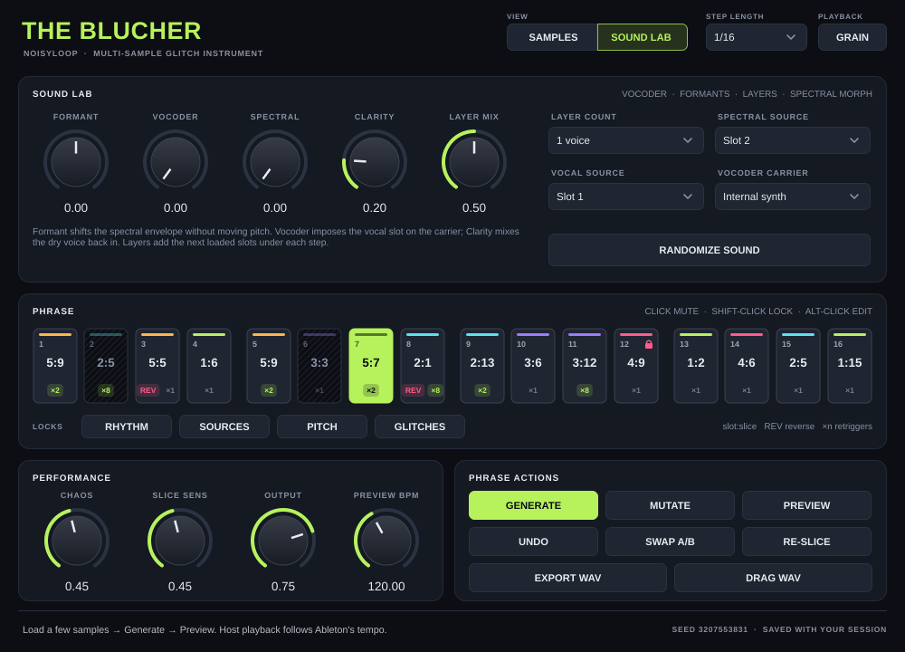
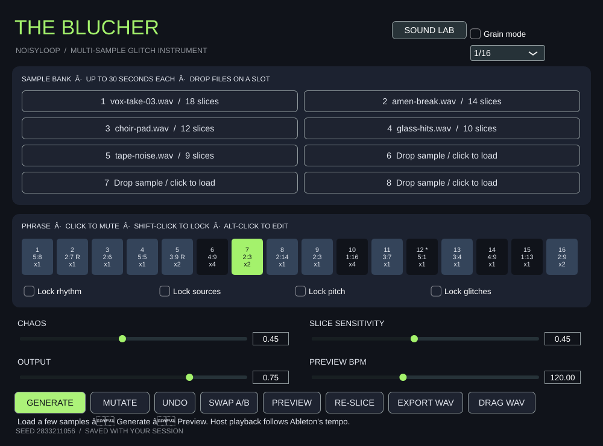
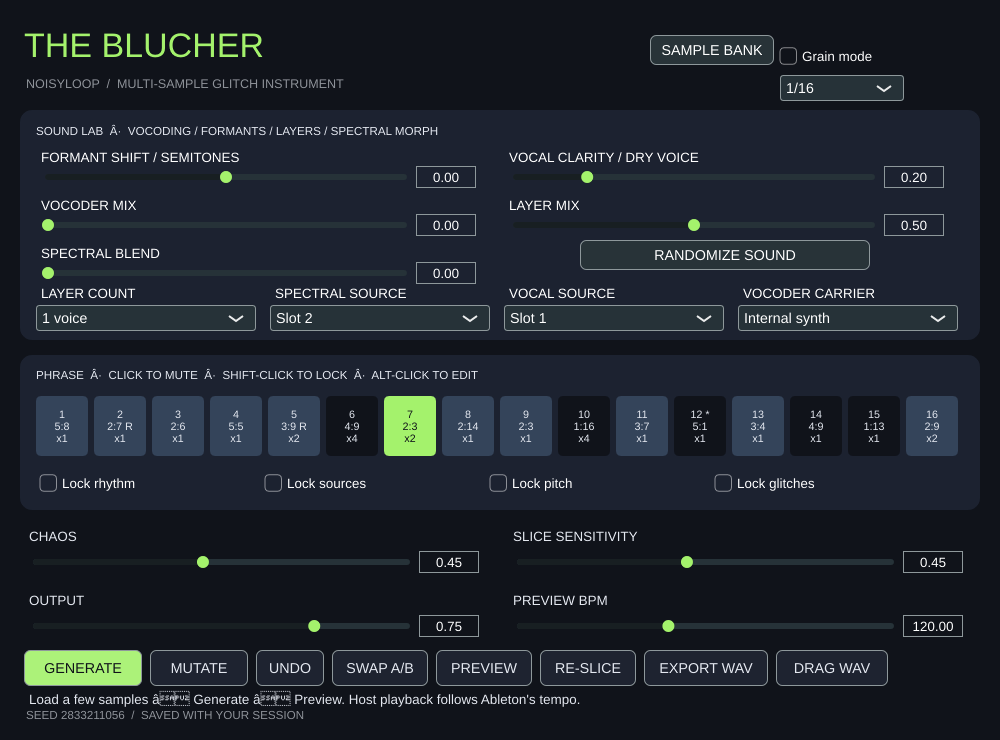

# The Blucher

Noisyloop's eight-slot sample slicing and glitch instrument, built with JUCE 8.0.10. The repository URL retains `the-blutcher`; the instrument is named **The Blucher**.



## Interface

The window is split into four areas:

- **Header**: the **Samples / Sound Lab** view switch, the **Step length** menu (straight, triplet, or dotted divisions), and the **Grain** playback toggle.
- **Sample bank / Sound Lab**: the top panel shows eight slot cards, or the Sound Lab knobs and source menus. Each slot has its own colour, and the step grid reuses it, so you can see which sample a step plays at a glance.
- **Phrase**: 16 steps in four beat groups. Each step shows its number, its `slot:slice`, a strip in the source slot's colour, **REV** when reversed, and `×n` for retriggers. Muted steps are hatched, locked steps show a padlock, and the playing step is highlighted. The **Locks** pills under the grid constrain Generate, Mutate, and Randomize Sound.
- **Performance and Phrase actions**: knobs for Chaos, Slice sensitivity, Output, and Preview BPM, next to the Generate / Mutate / Preview, Undo / Swap A/B / Re-slice, and Export / Drag WAV buttons. Status messages and the current seed appear in the footer.



<details>
<summary>Previous interface</summary>




</details>

## Get started in Ableton

Download **The-Blucher-macOS** from a successful [Actions build](../../actions), unzip it, and open the DMG. Quit Live and run `Install-The-Blucher.command`. The installer backs up existing bundles and installs the AU, VST3, and standalone app into your user account. These are ad-hoc signed development builds, not Apple-notarized distribution builds. Only run the installer for builds you trust.

1. Add The Blucher to a MIDI track.
2. Click a sample slot or drop audio onto it. Dropping multiple files fills successive slots. Each slot accepts up to 30 seconds at 8–192 kHz; WAV, AIFF, and FLAC are recommended.
3. Adjust **Slice sensitivity**, then press **Re-slice** to detect new transients. Sustained audio falls back to evenly spaced slices.
4. Press **Generate**, then **Preview**, or start Live's transport. While the host plays, the phrase follows host tempo and song position. Preview uses its own BPM when stopped.
5. Click a step to mute it; Shift-click to lock it. Alt/Option-click to edit the source, slice, pitch, reverse, and retriggers. Steps show source `slot:slice`, reverse (**REV**), and retrigger count (`×n`).
6. Use the **Rhythm / Sources / Pitch / Glitches** lock pills to constrain Generate and Mutate. **Mutate** changes only some unlocked steps; **Chaos** controls density of transformations. **Undo** restores the last phrase edit (64 edits); **Swap A/B** exchanges two phrase snapshots. Both snapshots use the same sample bank and global controls.
7. Choose straight, triplet, or dotted divisions from **Step length** in the header. This host-automatable control changes the length of all 16 steps. **Grain** repeats short windowed fragments within each slice.
8. Switch the view to **Sound Lab** to set a formant shift independently of playback pitch, layer up to four loaded slots, blend a second sample spectrum, and vocode a selected vocal slot using the internal harmonic synth or a selected sample carrier. **Vocal clarity** mixes the original vocal back into the vocoder for intelligibility. Layer voices follow the same step/slice/pitch/retrigger settings, selecting the next loaded slots after the main source. Spectral blending interpolates magnitudes while keeping the main signal phase.
9. **Randomize Sound** varies Sound Lab controls using Chaos and the source/pitch/glitch locks. Undo restores the previous sound and phrase. A/B remains a pair of phrase snapshots sharing the sound controls.
10. **Export WAV** saves a stereo 24-bit / 44.1 kHz phrase. **Drag WAV** renders the current phrase and starts an external file drag to an Ableton audio track. Rendering uses the last known host tempo (preview tempo after a stopped-host processing block).

MIDI notes also open playback while held, with C3/MIDI 60 as the original pitch and other notes transposing the phrase. Playback follows the global phrase clock; note-on does not restart it. During host transport playback the phrase runs continuously regardless of held notes. Stop transport and Preview for note-gated auditioning.

## Sound and state

This is a rhythmic sample collage engine: source selection, transient slices, pitch shifts, reversals, up to eight retriggers per step, gated envelopes, and optional grain playback. Sound Lab adds simultaneous sample layers and an STFT processor for spectral blending, broad spectral-envelope formant shifts, and vocoder envelope transfer. Formant shifting changes the envelope without moving the pitch bins; results depend on the source and this is not a speech-analysis or voice-cloning model. Sample pitch shifting changes playback speed.

The spectral engine uses 1024-frame windows with fourfold overlap and reports 1024 samples of latency to the host (about 23 ms at 44.1 kHz). WAV export compensates for that latency. Live playback and offline export use the same renderer. Sample import and final output are bounded to prevent digital overs. The internal carrier is a band-limited harmonic oscillator; MIDI transposition and per-step pitch affect its note. Vocoding and spectral blending use slices from the selected source slots, not full-file continuous playback.

Ableton sessions and host presets embed the sample audio, exact slice boundaries, both patterns, seed, locks, and automatable controls, including Sound Lab settings. Original audio files are not needed to reopen a session. Large sample banks increase session size. Undo history and Preview running state are intentionally temporary. Generate is deterministic for a given seed, bank, settings, and starting pattern; normal generation chooses a fresh seed and saves the resulting pattern.

Sample decode, analysis, generation, state serialization, and export run outside the audio callback. The callback uses a non-blocking try-lock and outputs silence if the bank is being replaced or saved; loading/reslicing/saving can therefore briefly interrupt audio. The spectral callback uses fixed arrays and no heap allocation. There is no network or AI dependency.

## Build

Requires CMake 3.22+, a C++17 compiler, and network access for JUCE on initial configure.

```sh
cmake -S . -B build -G Xcode -DCMAKE_OSX_DEPLOYMENT_TARGET=12.0 '-DCMAKE_OSX_ARCHITECTURES=arm64;x86_64'
cmake --build build --config Release --parallel 3
ctest --test-dir build -C Release --output-on-failure
```

The macOS Actions workflow builds universal Intel/Apple Silicon AU, VST3, and standalone bundles, runs engine and JUCE state/export roundtrip tests, ad-hoc signs the bundles, and packages a DMG. The workflow runs on PRs, main pushes, and manual dispatch.

Dependency-free engine tests can also be run on Linux:

```sh
g++ -std=c++17 -Wall -Wextra -pedantic -fsanitize=address,undefined -g tests/EngineTests.cpp -ISource -o engine-tests
./engine-tests
```

## Release checks in Live

Before relying on a release, load contrasting samples, generate/lock/mutate, automate the division, test tempo changes and transport jumps, compare WAV export with latency-compensated playback, test each Sound Lab module and its source selection, then save/reopen a Live set with original files moved. Check mono/stereo operation, AU/VST3 scanning, and MIDI note-off behavior. CI covers build, core DSP invariants, spectral reconstruction/latency, vocoder gating, and embedded-state/playback/export roundtrips; it does not run Ableton.
